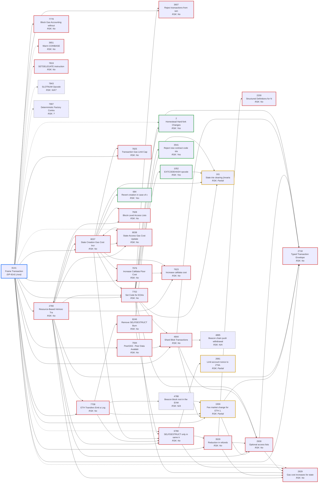

# EIP-8141 (Frame Transaction): dependency tree and Rootstock status

EIP-8141 is **Draft** (created 2026-01-29). This is Task 1 in `readme.md`: `requires:` walked to depth 3, plus the EIPs that are only cited in the 8141 body ("soft", not expanded).

Sources: `ethereum/EIPs` (fetched 2026-10-27) for preambles and the hardfork metas (7600 Pectra, 7607 Fusaka, 7773 Glamsterdam); `rsksmart/rskj` master `1e95a3b` and `rsksmart/RSKIPs` `a389ec2` for Rootstock status. See `rsk-eip-status.md` for the wider evidence.

Legend: **hard** = reached through `requires`; **soft** = only cited in the 8141 body; **hard + cited** = both. RSK: Yes / Partial / No / N/A / ? (not verified). ⚠ = not Final yet, so the spec can still change.

## Project assumptions

Decided 2026-10-27 (see the notes under Observations). The `Under assumptions` column below applies them; the `RSK` column stays as today's mainnet state.

1. **Typed transactions will be activated:** RSKIP-543 (2718 envelope), RSKIP-545 (7702 set-code) and RSKIP-546 (Type 1/2 encodings). Their latest versions are open PRs [#708](https://github.com/rsksmart/RSKIPs/pull/708) (543), [#710](https://github.com/rsksmart/RSKIPs/pull/710) (545) and [#709](https://github.com/rsksmart/RSKIPs/pull/709) (546). RSKIP-544 (EIP-3541) is already active since Vetiver.
2. **Storage rent RSKIPs count as rejected:** 07, 17 (already Rejected); 21, 27, 52, 61, 113 (Withdrawn); 240 (Deferred). Storage rent can't be used as a reason to skip an EIP.
3. **No EIP-2929 gas differences on Rootstock.** 8141 gas will be defined without warm/cold access pricing, with our own rationale.
4. **Blobs aren't critical to frame txs.** If needed, EIP-4844 can be activated via RSKIP-558.

## Nodes

| Depth | EIP | Title | Dep | EIP status | Ethereum fork | Required by | RSK | RSK evidence | Under assumptions |
|---|---|---|---|---|---|---|---|---|---|
| 1 | [1559](https://eips.ethereum.org/EIPS/eip-1559) | Fee market change for ETH 1.0 chain | hard | Final | London | 4788, 4844, 7708, 8141 | **Partial** | Only the BASEFEE opcode (EIP-3198 via RSKIP-412, Arrowhead); no fee market, no Type-2 tx. RSKIP-546 (Type 1/2 envelopes) is Draft. | **Partial**: Type-2 encoding via RSKIP-546 ([PR #709](https://github.com/rsksmart/RSKIPs/pull/709)); base fee effectively zero, no dynamic fee market. |
| 1 | [2718](https://eips.ethereum.org/EIPS/eip-2718) | Typed Transaction Envelope | hard | Final | Berlin | 1559, 2780, 2930, 4844, 7702, 8141 | **No** | RSKIP-543 Typed Transaction Envelope: Draft. | **Assumed**: RSKIP-543 ([PR #708](https://github.com/rsksmart/RSKIPs/pull/708)). |
| 1 | [2780](https://eips.ethereum.org/EIPS/eip-2780) | Resource-Based Intrinsic Transaction Gas | hard | Last Call ⚠ | Glamsterdam (scheduled) | 8037, 8141 | **No** | No RSKIP. | same |
| 1 | [3529](https://eips.ethereum.org/EIPS/eip-3529) | Reduction in refunds | hard | Final | London | 6780, 8141 | **No** | Pre-London refunds still in `GasCost.java` (REFUND_SSTORE 15000, SUICIDE_REFUND 24000). | same |
| 1 | [3607](https://eips.ethereum.org/EIPS/eip-3607) | Reject transactions from senders with deployed code | hard | Final | Retroactive (all forks) | 7702, 8141 | **No** | Not adopted; rskj doesn't check sender code. RSKIP-545 (PR #710) says it isn't needed for 7702 on RSK. | **Not needed**: RSKIP-545: RSK doesn't check sender code, so no 7702 exception needed. 8141's own sender rules still need to be checked. |
| 1 | [4844](https://eips.ethereum.org/EIPS/eip-4844) | Shard Blob Transactions | hard | Final | Cancun | 7594, 7702, 8141 | **No** | RSKIP-558 Blob Carrying Transactions: Draft. | **If needed**: Can be activated via RSKIP-558; not critical for frame txs. |
| 1 | [7594](https://eips.ethereum.org/EIPS/eip-7594) | PeerDAS - Peer Data Availability Sampling | hard | Final | Fusaka | 8141 | **No** | PeerDAS; only referenced by RSKIP-558 (Draft). No blobs on RSK. | **Not needed**: Only matters if blobs are used; PeerDAS is DA-layer networking. |
| 1 | [7702](https://eips.ethereum.org/EIPS/eip-7702) | Set Code for EOAs | hard | Final | Prague | 2780, 8037, 8141 | **No** | RSKIP-545 Set Code for EOAs: Draft. | **Assumed**: RSKIP-545 ([PR #710](https://github.com/rsksmart/RSKIPs/pull/710)). |
| 1 | [7708](https://eips.ethereum.org/EIPS/eip-7708) | ETH Transfers Emit a Log | hard | Last Call ⚠ | Glamsterdam (scheduled) | 2780, 8141 | **No** | No RSKIP. | same |
| 1 | [7778](https://eips.ethereum.org/EIPS/eip-7778) | Block Gas Accounting without Refunds | hard | Last Call ⚠ | Glamsterdam (scheduled) | 8141 | **No** | No RSKIP. | same |
| 1 | [7825](https://eips.ethereum.org/EIPS/eip-7825) | Transaction Gas Limit Cap | hard | Final | Fusaka | 8037, 8141 | **No** | Only a mempool sanity cap of 2^60 (`Constants.TRANSACTION_GAS_CAP`, `TxValidatorGasLimitValidator.java:40`) plus the block gas limit; 7825's consensus cap is 2^24. | same |
| 1 | [7976](https://eips.ethereum.org/EIPS/eip-7976) | Increase Calldata Floor Cost | hard | Last Call ⚠ | Glamsterdam (scheduled) | 8037, 8141 | **No** | No RSKIP. | same |
| 1 | [8037](https://eips.ethereum.org/EIPS/eip-8037) | State Creation Gas Cost Increase | hard | Last Call ⚠ | Glamsterdam (scheduled) | 2780, 8038, 8141 | **No** | No RSKIP. | same |
| 1 | [3651](https://eips.ethereum.org/EIPS/eip-3651) | Warm COINBASE | soft | Final | Shanghai | 8141 (body) | **No** | Needs 2929. | **Won't**: Only meaningful with 2929. |
| 1 | [7819](https://eips.ethereum.org/EIPS/eip-7819) | SETDELEGATE instruction | soft | Draft ⚠ | — | 8141 (body) | **No** | No RSKIP. | same |
| 1 | [7843](https://eips.ethereum.org/EIPS/eip-7843) | SLOTNUM Opcode | soft | Last Call ⚠ | Glamsterdam (scheduled) | 8141 (body) | **N/A?** | SLOTNUM is beacon-slot based; RSK would need an equivalent or a no-op. | same |
| 1 | [7997](https://eips.ethereum.org/EIPS/eip-7997) | Deterministic Factory Contract | soft | Last Call ⚠ | Glamsterdam (scheduled) | 8141 (body) | **?** | No RSKIP; check whether an equivalent factory is deployed on RSK. | same |
| 2 | [2](https://eips.ethereum.org/EIPS/eip-2) | Homestead Hard-fork Changes | hard + cited | Final | Homestead | 7702 | **Yes** | Complete since Lovell. (1) 53000 gas for contract-creation txs and (2) low-s signatures (`Transaction.java:321`) from genesis; (3) failed code deposit leaves no empty contract: top-level creates from genesis (`TransactionExecutor` rollback), internal CREATE/CREATE2 only since RSKIP-453 (Lovell, block 7,338,024; `Program.java:738`). (4) Difficulty formula: N/A, RSK uses its own. | same |
| 2 | [161](https://eips.ethereum.org/EIPS/eip-161) | State trie clearing (invariant-preserving alternative) | hard | Final | Spurious Dragon | 1052, 7702, 8037, 8246 | **Partial** | Only rule (a), and only for CREATE/CREATE2: new contracts start at nonce 1 since RSKIP-125 (Wasabi; `Program.java:592`); contract-creation txs still start at 0 (`TransactionExecutor.java:403`). (b) 25000 new-account gas is charged even for zero value (`VM.java:1734`, `:1797`). (c) A zero-value transfer creates an empty account (`MutableRepository.java:322`). (d) No end-of-tx deletion of touched empty accounts; only SUICIDE deletions (`TransactionExecutor.java:622`). | same |
| 2 | [684](https://eips.ethereum.org/EIPS/eip-684) | Revert creation in case of collision | hard | Final | Retroactive (all forks) | 8037 | **Yes** | `Program.java:547` `addressCollisionException`. | same |
| 2 | [1052](https://eips.ethereum.org/EIPS/eip-1052) | EXTCODEHASH opcode | hard | Final | Constantinople | 7702 | **Yes** | RSKIP-140 (Papyrus), fixed by RSKIP-169 (Iris). | same |
| 2 | [2200](https://eips.ethereum.org/EIPS/eip-2200) | Structured Definitions for Net Gas Metering | hard | Final | Istanbul | 3529 | **No** | Flat SSTORE costs in `GasCost.java`. | same |
| 2 | [2929](https://eips.ethereum.org/EIPS/eip-2929) | Gas cost increases for state access opcodes | hard + cited | Final | Berlin | 2780, 2930, 3529, 6780, 7702 | **No** | Not adopted; see RSKIP-239 (Reprice Trie Read Opcodes, cites 2929). | **Won't**: Project decision: 2929 gas differences not implemented; 8141 gas defined with RSK rationale. |
| 2 | [2930](https://eips.ethereum.org/EIPS/eip-2930) | Optional access lists | hard | Final | Berlin | 1559, 2780, 3529, 4844, 7702 | **No** | Needs 2718/2929; RSKIP-546 (Draft) covers the Type-1 envelope. | **Partial**: Type-1 encoding and access-list gas via RSKIP-546; the access list has no effect on execution (no 2929). |
| 2 | [3541](https://eips.ethereum.org/EIPS/eip-3541) | Reject new contract code starting with the 0xEF byte | hard | Final | London | 7702 | **Yes** | RSKIP-544, Vetiver (block 8,804,200). | same |
| 2 | [4788](https://eips.ethereum.org/EIPS/eip-4788) | Beacon block root in the EVM | hard | Final | Cancun | 7708 | **N/A** | Beacon-chain specific. | same |
| 2 | [4895](https://eips.ethereum.org/EIPS/eip-4895) | Beacon chain push withdrawals as operations | hard | Final | Shanghai | 4844 | **N/A** | Beacon-chain specific. | same |
| 2 | [6780](https://eips.ethereum.org/EIPS/eip-6780) | SELFDESTRUCT only in same transaction | hard + cited | Final | Cancun | 2780, 7708, 8037, 8246 | **No** | No same-tx restriction visible in `VM.doSUICIDE` (light check). | same |
| 2 | [7623](https://eips.ethereum.org/EIPS/eip-7623) | Increase calldata cost | hard | Final | Prague | 2780, 7976, 8037 | **No** | No RSKIP. | same |
| 2 | [7928](https://eips.ethereum.org/EIPS/eip-7928) | Block-Level Access Lists | hard | Last Call ⚠ | Glamsterdam (scheduled) | 2780, 8037 | **No** | No RSKIP. | same |
| 2 | [8038](https://eips.ethereum.org/EIPS/eip-8038) | State-Access Gas Cost Update | hard + cited | Last Call ⚠ | Glamsterdam (scheduled) | 2780, 8037 | **No** | No RSKIP. | **Replace**: Assumes 2929-style state-access pricing; replace with RSK 8141 gas rationale. |
| 2 | [8246](https://eips.ethereum.org/EIPS/eip-8246) | Remove SELFDESTRUCT Burn | hard | Last Call ⚠ | Glamsterdam (scheduled) | 7708 | **No** | No RSKIP. | same |
| 3 | [2681](https://eips.ethereum.org/EIPS/eip-2681) | Limit account nonce to 2^64-1 | hard | Final | — (client rule, not fork-bound) | 6780 | **Partial** | Mempool only: `TxValidatorNonceEncodingValidator.java` rejects nonces over 8 bytes (≤ 2^64-1). No consensus rule or RSKIP; no overflow check on increment. | same |

Not expanded (`requires` of depth-3 nodes): none; the tree is complete.

## Graph

Solid arrows = `requires`; dashed = cited in the body only. Each box shows its Rootstock status; the border repeats it: green = on RSK, amber = partial, red = missing, grey dashed = N/A or unverified, blue = EIP-8141.

## What's missing on Rootstock

- **Direct requirements (depth 1), 13:** [1559](https://eips.ethereum.org/EIPS/eip-1559) (Partial), [2718](https://eips.ethereum.org/EIPS/eip-2718) (No), [2780](https://eips.ethereum.org/EIPS/eip-2780) (No), [3529](https://eips.ethereum.org/EIPS/eip-3529) (No), [3607](https://eips.ethereum.org/EIPS/eip-3607) (No), [4844](https://eips.ethereum.org/EIPS/eip-4844) (No), [7594](https://eips.ethereum.org/EIPS/eip-7594) (No), [7702](https://eips.ethereum.org/EIPS/eip-7702) (No), [7708](https://eips.ethereum.org/EIPS/eip-7708) (No), [7778](https://eips.ethereum.org/EIPS/eip-7778) (No), [7825](https://eips.ethereum.org/EIPS/eip-7825) (No), [7976](https://eips.ethereum.org/EIPS/eip-7976) (No), [8037](https://eips.ethereum.org/EIPS/eip-8037) (No).
- **Transitive (depth 2–3), 10:** [161](https://eips.ethereum.org/EIPS/eip-161) (Partial), [2200](https://eips.ethereum.org/EIPS/eip-2200) (No), [2929](https://eips.ethereum.org/EIPS/eip-2929) (No), [2930](https://eips.ethereum.org/EIPS/eip-2930) (No), [6780](https://eips.ethereum.org/EIPS/eip-6780) (No), [7623](https://eips.ethereum.org/EIPS/eip-7623) (No), [7928](https://eips.ethereum.org/EIPS/eip-7928) (No), [8038](https://eips.ethereum.org/EIPS/eip-8038) (No), [8246](https://eips.ethereum.org/EIPS/eip-8246) (No), [2681](https://eips.ethereum.org/EIPS/eip-2681) (Partial).
- **Soft (cited only), 3:** [3651](https://eips.ethereum.org/EIPS/eip-3651) (No), [7819](https://eips.ethereum.org/EIPS/eip-7819) (No), [7997](https://eips.ethereum.org/EIPS/eip-7997) (?).
- **Already on RSK:** [2](https://eips.ethereum.org/EIPS/eip-2), [684](https://eips.ethereum.org/EIPS/eip-684), [1052](https://eips.ethereum.org/EIPS/eip-1052), [3541](https://eips.ethereum.org/EIPS/eip-3541).

### Remaining work under the project assumptions

After applying the assumptions, **18** EIPs still need an RSK decision or an RSKIP, and **2** are unverified or need a substitute.

- **Needs a decision or RSKIP:** [1559](https://eips.ethereum.org/EIPS/eip-1559) (Partial), [2780](https://eips.ethereum.org/EIPS/eip-2780) (No), [3529](https://eips.ethereum.org/EIPS/eip-3529) (No), [7708](https://eips.ethereum.org/EIPS/eip-7708) (No), [7778](https://eips.ethereum.org/EIPS/eip-7778) (No), [7825](https://eips.ethereum.org/EIPS/eip-7825) (No), [7976](https://eips.ethereum.org/EIPS/eip-7976) (No), [8037](https://eips.ethereum.org/EIPS/eip-8037) (No), [7819](https://eips.ethereum.org/EIPS/eip-7819) (No), [161](https://eips.ethereum.org/EIPS/eip-161) (Partial), [2200](https://eips.ethereum.org/EIPS/eip-2200) (No), [2930](https://eips.ethereum.org/EIPS/eip-2930) (Partial), [6780](https://eips.ethereum.org/EIPS/eip-6780) (No), [7623](https://eips.ethereum.org/EIPS/eip-7623) (No), [7928](https://eips.ethereum.org/EIPS/eip-7928) (No), [8038](https://eips.ethereum.org/EIPS/eip-8038) (Replace), [8246](https://eips.ethereum.org/EIPS/eip-8246) (No), [2681](https://eips.ethereum.org/EIPS/eip-2681) (Partial).
- **Unverified or needs a substitute:** [7843](https://eips.ethereum.org/EIPS/eip-7843) (N/A?), [7997](https://eips.ethereum.org/EIPS/eip-7997) (?).

### Observations

- **Rootstock has no typed transactions at all.** No 2718 handling in rskj master, and none of RSKIP-543/545/546 is in `ConsensusRule.java`. EIP-2718 is the base of the tree: 1559, 2930, 4844, 7702 and 8141 itself all depend on it. RSKIP-543/545/546 (envelope, 7702, Type 1/2) exist but are Draft, so they're the natural first step.
  * @claude: For this project, assume that RSKIP-543, 545, and 546 will be activated. 
  * For the present, the lates versions of these RSKIPS live as PRs 708, 709, and 710 
  * → Applied as assumption 1 (PR #708 = RSKIP-543, #709 = RSKIP-546, #710 = RSKIP-545). RSKIP-546 gives 1559 and 2930 their encodings only: base fee is effectively zero, and the access list is charged for bandwidth but doesn't affect execution.
- **Gas-model conflicts.** 2929, 2930, 3529 and 3651, plus the newer 2780, 7778, 8037 and 8038, all assume Ethereum's access-list, refund and state-gas model. Rootstock's storage rent design deliberately did not adopt 2929. Each of these needs an explicit RSK decision: adopt, adapt, or define 8141 gas without it.
  * @claude: For this project, treat all storage rent related RSKIPs as rejected. 
  * @claude: for the present, assume that gas price difference from eip-2929 will not be implemented on Rootstock. We will define 8141 gas without it - with our own rationale.
  * → Applied as assumptions 2 and 3. 2929 and 3651 become Won't, and 8038 becomes Replace. Still open: 3529 (refund reduction), 2200, and the newer gas EIPs 2780, 7778, 7623, 7976 and 8037. These are 2929-independent and need individual decisions as part of the RSK 8141 gas rationale. EIP-161 (required by 7702 and 8037) is only partly active: new contracts start at nonce 1, but none of the empty-account rules apply, so zero-value calls still create accounts. That matters for 8037's state-creation charging, and it needs a decision like the gas EIPs above.
- **Blob dependencies.** 4844 and 7594 are in `requires` mainly for BLOBHASH and the blob-wrapper format. Rootstock has no blobs (RSKIP-558 is Draft). We need to establish whether 8141 can work on RSK without them, for example with zero blobs per frame tx.
  * @claude: blobs are not critical to frame transactions. For this project we can assume that if needed, eip-4844 can be activated on Rootstock (RSKIP-558)
  * → Applied as assumption 4: 4844 is If needed, 7594 is Not needed.
- **Beacon-chain items (4788, 4895, 7843 SLOTNUM)** don't map to Rootstock and need an RSK-specific substitute or exclusion.
- **Moving targets.** 8141 is Draft, and 2780, 7708, 7778, 7843, 7928, 7976, 7997, 8037, 8038 and 8246 are Last Call. Most are scheduled for Glamsterdam, so their specs may still change.
- **Still to verify:** 7997, marked `?` above. Resolved: 3607 (not adopted, not needed per RSKIP-545) and 161 (Partial: nonce rule only, checked rule by rule).
